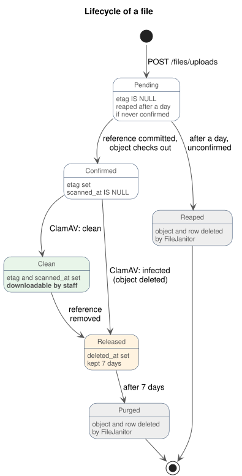

# Files

The Files module stores every file a user uploads — today a candidate's CV, cover letter and other application documents.
This guide covers how uploads and downloads work, the lifecycle of a file, the malware scan and cleanup, and how a
module adds a file to one of its records. It has two audiences:

- **Frontend:** which endpoint to call, what to send, and how to handle a reference that has no file behind it.
- **Backend:** how the module works, and how to give an entity a file column.

Every file has the same access rule (§8). Decisions: [ADR-005](../../architecture/ADR.md#adr-005-object-storage--azure-blob-storage) and
[ADR-A010](../../architecture/ADR-ASPNET.md#adr-a010-file-storage--azure-blob-storage-via-azure-sdk). Table:
[`files.file`](../../db/modules/files.md).

## Table of contents

1. [Mental model](#1-mental-model)
2. [Lifecycle of a file](#2-lifecycle-of-a-file)
3. [Vocabulary](#3-vocabulary)
4. [Endpoints](#4-endpoints)
5. [Frontend: uploading a file](#5-frontend-uploading-a-file)
6. [Frontend: downloading a file](#6-frontend-downloading-a-file)
7. [Frontend: a reference may have no file](#7-frontend-a-reference-may-have-no-file)
8. [Access and content rules](#8-access-and-content-rules)
9. [Confirm and release](#9-confirm-and-release)
10. [Malware scan and the janitor](#10-malware-scan-and-the-janitor)
11. [Backend: add a file to an entity](#11-backend-add-a-file-to-an-entity)
12. [Storage and wiring](#12-storage-and-wiring)
13. [Quick reference](#13-quick-reference)

## 1. Mental model

- **File bytes never pass through the API.** The client asks the API for a short-lived presigned URL and uploads or
  downloads directly to Azure Blob Storage (Azurite locally). The API stores and checks only the metadata, in
  `files.file`.
- **Every file has a purpose.** The purpose (`application_document`) is the file's kind. It decides which content types
  and sizes are accepted. The module that owns the feature declares it; the Files module enforces it.
- **References are logical.** Another module's row points at a file by id, with no foreign key. The Files module owns the
  file's lifecycle, and follows the references through the owning module's transactional outbox.
- **Referencing confirms, dereferencing deletes.** There is no confirm endpoint and no delete endpoint. A file becomes
  real when a row references it, and is released when the row stops referencing it.
- **Nothing reaches staff unscanned.** A confirmed file is downloadable only after ClamAV has found it clean.

## 2. Lifecycle of a file

The row has no status column. Its state follows from three columns:

| State | Columns | Downloadable |
| ----- | ------- | ------------ |
| **Pending** | `etag IS NULL` | no (404) |
| **Confirmed** | `etag` set, `scanned_at IS NULL` | no (404) |
| **Clean** | `etag` and `scanned_at` set | yes |
| **Released** | `deleted_at` set | no (404) |
| **Purged** | object and row removed | no (404) |



> **A file is confirmed by being referenced, not by a client call.** When a committed row starts pointing at a file, its
> change reaches the Files module through the owning module's outbox. The Files module checks the object that actually
> landed and records its real size and ETag. A file nobody references never confirms and is reaped. This is why the
> client must **upload the bytes before saving the reference**.

## 3. Vocabulary

| Term | Meaning |
| ---- | ------- |
| **Presigned URL** | A time-limited URL for one blob. The upload URL may only create the blob (10 minutes). The download URL may only read it (5 minutes). It is a SAS URL on Azure. |
| **Purpose** | The file's kind, an `IFilePurpose` declared by the owning module: key, accepted content types, maximum size. |
| **Pending / confirmed** | A file is pending (`etag IS NULL`) until a committed row references it and its object passes the purpose's rules. |
| **Clean** | ClamAV scanned the confirmed object and found nothing (`scanned_at` set). |
| **Released** | The file lost its reference (`deleted_at` set). Its bytes stay 7 days, then the janitor removes them. |
| **Object key** | The server-generated blob name, `uploads/{id}.ext`. The extension comes from the validated content type, never the client's file name, which is kept on the row for display and downloads. |

## 4. Endpoints

Both endpoints are under the versioned group `/api/v1/files`.

| Method and path | Who | Purpose |
| --------------- | --- | ------- |
| `POST /files/uploads` | anyone, signed in or not | Creates a pending file and returns its id, the upload URL and the headers to send. |
| `GET /files/{fileId}/url` | any staff role | Returns a download URL for a clean file. |

There is no confirm endpoint: saving the reference confirms the file (§9). There is no delete endpoint: deleting or
changing the referencing record releases it (§9).

## 5. Frontend: uploading a file

Three steps. **Order matters: upload the bytes before saving the record that references the file.**

### 5.1 Ask for an upload URL

```http
POST /api/v1/files/uploads
Content-Type: application/json
```

```json
{
  "purpose": "application_document",
  "fileName": "životopis.pdf",
  "contentType": "application/pdf",
  "sizeBytes": 482113
}
```

No token is needed. The API answers `200` with the file's id and where to upload it:

```json
{
  "fileId": "019a6b2e-3c4d-7e5f-8a90-112233445566",
  "uploadUrl": "https://<account>.blob.core.windows.net/files/uploads/019a6b2e3c4d7e5f8a90112233445566.pdf?sv=…&sp=c&sig=…",
  "uploadHeaders": {
    "Content-Type": "application/pdf",
    "x-ms-blob-type": "BlockBlob"
  },
  "expiresAt": "2026-11-09T10:10:00Z"
}
```

When the purpose is unknown, or it does not accept the content type or size, the API answers `400` with a Slovak
message per field ([errors.md](../errors/errors.md)), keyed `Purpose`, `ContentType` or `SizeBytes`:

```json
{
  "status": 400,
  "title": "Bad Request",
  "detail": "Niektoré údaje nie sú vyplnené správne.",
  "errors": {
    "ContentType": ["Tento typ súboru nie je povolený."],
    "SizeBytes": ["Súbor je väčší ako povolených 10 MB."]
  }
}
```

### 5.2 Upload the bytes to storage

```http
PUT <uploadUrl>
Content-Type: application/pdf
x-ms-blob-type: BlockBlob

<the raw bytes of the file>
```

Storage answers `201` directly; the API is not involved.

- **Send every header from `uploadHeaders`, exactly as given.** Azure refuses a `PUT` without `x-ms-blob-type`. The
  `Content-Type` must equal the `contentType` you declared, or the confirm in step 5.3 refuses the file.
- **The URL works for 10 minutes and once.** It can create the blob but not overwrite it. To replace a file, start again
  at step 5.1.

### 5.3 Reference the file

Save the record the file belongs to, with `fileId` in its file field, for example the application's CV. Once that save
commits, the server confirms the file, usually within milliseconds.

- **The save can answer `400` for the file field**, with a Slovak message to show next to it, when the file is unknown,
  its upload never finished, it is larger than the purpose allows, it is empty, its stored type differs from the
  declared one, or its upload window expired. In each case the user uploads the file again.
- **If the app dies between steps 5.2 and 5.3**, nothing references the file. It is never confirmed, and the janitor
  removes it after a day. Nothing is left behind.

## 6. Frontend: downloading a file

```http
GET /api/v1/files/{fileId}/url
Authorization: Bearer <staff access token>
```

The API answers `200` with a short-lived URL and what the file is:

```json
{
  "url": "https://<account>.blob.core.windows.net/files/uploads/019a6b2e3c4d7e5f8a90112233445566.pdf?sv=…&sp=r&sig=…",
  "fileName": "životopis.pdf",
  "contentType": "application/pdf",
  "sizeBytes": 482113,
  "expiresAt": "2026-11-09T10:05:00Z"
}
```

Then `GET <url>` for the bytes. Other answers:

| Status | When |
| ------ | ---- |
| `404` | the file is unknown, pending, not yet scanned or released (§7) |
| `401` | no valid staff token |

The URL lasts **5 minutes**, so request it when the user opens the file and do not cache it. Storage answers with
`Content-Disposition: attachment` and the uploaded file name (diacritics kept in `filename*`), so the browser saves the
file instead of rendering it on the storage origin. The saved name always ends in an extension of the checked type: a
PDF uploaded as `cv.exe` is saved as `cv.exe.pdf`. `fileName` in the response stays the uploaded name, for display.

## 7. Frontend: a reference may have no file

A record can hold a file id with **no downloadable file behind it**. Show a placeholder ("súbor nie je k dispozícii"),
not an error state. It happens when:

- ClamAV has **not scanned it yet**: a file confirmed a moment ago, or ClamAV is restarting. The scan runs every 30
  seconds, so retry later.
- ClamAV found it **infected**: its bytes were deleted and the file released.
- The file was **released** and a stale screen still shows the old id.

**Rule:** treat `GET /files/{id}/url` → `404` as "no file available". A non-null file id does not guarantee a
downloadable file.

## 8. Access and content rules

**Access is the same for every file.** Anyone may ask for an upload URL, because applicants are anonymous. Only signed-in
staff with any role may ask for a download URL. There are no per-purpose permissions and no read grants. The record that references a file decides who
learns its id; the Files module does not check it again.

The upload endpoint is bounded by the per-IP rate limit like every anonymous endpoint
([ADR-A007](../../architecture/ADR-ASPNET.md#adr-a007-rate-limiting--aspnet-core-rate-limiting)). The ALTCHA check
([ADR-022](../../architecture/ADR.md#adr-022-bot-protection--altcha-on-the-application-form)) guards the application
submit (`Kernel.Altcha`, `.RequireAltcha()`), not yet this endpoint: each solution is accepted once, so requiring it
here would make the form solve a challenge per file.

**Content rules come from the purpose**, an `IFilePurpose` in Kernel:

```csharp
public interface IFilePurpose
{
    string Key { get; }                              // "application_document"
    IReadOnlySet<string> AllowedContentTypes { get; } // compared without case
    long MaxSizeBytes { get; }
}
```

The upload intent checks the declared content type and size against the purpose. These are only the client's
declarations about bytes that do not exist yet, so confirm checks what actually landed:

| Rule | Enforced at intent | Enforced when referenced (validation and confirm) |
| ---- | ------------------ | ------------------------------------------------- |
| Content type | declared type must be accepted | the stored blob's type must equal the declared one. A SAS URL cannot bind the type, so the client can send another, and confirm catches it. |
| Content | — | the blob's first 1024 bytes must be what a file of the declared type begins with (`FileTypes`): `%PDF-` for PDF, the OLE header for `.doc`, a ZIP header for `.docx`, `FF D8 FF` for JPEG, the PNG signature for PNG. A bitmap or an executable renamed and declared as a PDF is refused. |
| Size | declared size ≤ maximum | the real size ≤ maximum and > 0. A SAS URL cannot bind the size. |
| Overwrite | — | the upload SAS has only the *create* permission, so the bytes confirm checked cannot be replaced afterwards. |

A file that breaks a rule is **never confirmed**. It stays pending and is reaped like an abandoned upload, so oversize
bytes are not kept for the retention window. Only the leading bytes are checked: a `.docx` is a ZIP whose parts are not
opened, and a file that starts right can still be broken further in. ClamAV is the check on the rest of the content.

A content type a purpose accepts must also be known to `FileTypes`, or no file of it is ever confirmed;
`FileTypesTests` fails when `application_document` accepts a type `FileTypes` does not know.

## 9. Confirm and release

A file follows its references. The owning module never calls the Files module to confirm or release a file: it saves
its row, and the change reaches the Files module through the owning module's **transactional outbox**
([conventions.md § Outbox pattern](../../db/conventions.md#outbox-pattern-outbox_message), [implementation-guide §9](../implementation-guide.md#9-cross-module-communication)).

```text
write handler                     owning module's database                 Files module
─────────────                     ────────────────────────                 ────────────
IFileReferences.ValidateAsync ──► (reads files.file and the blob; writes nothing)
SaveChanges ────────────────────► application_document row  ┐ one
                                  outbox_message row         ┘ transaction
                                          │
                       OutboxDispatcher ──┴──► FileReferenceHandler: confirm / release
```

### 9.1 Declaring a file column (FileReference)

The owning module registers a **`FileReference`** (Kernel) per table that holds file ids, naming each file-bearing
property and the purposes it accepts. The table's entity is an `ITrackedEntity` on a context with change capture, so
its inserts, updates and deletes are written to the module's outbox with the row before and after:

```csharp
services.AddSingleton(new FileReference(ModuleTypes.ModuleName, "application_document",
    [new FileColumn(nameof(ApplicationDocument.FileId), [ApplicationDocumentPurpose.PurposeKey])]));
```

The property is the **CLR property name** (`FileId`), which is how change capture keys the row's values.

### 9.2 Validate before saving (IFileReferences)

The write handler checks the file before saving the row, so a bad upload fails the write with a `400` the client can act
on, instead of saving a reference to a file that will never be downloadable:

```csharp
public interface IFileReferences
{
    Task<ReferencedFile> ValidateAsync(
        Guid fileId, string field, IReadOnlyCollection<string> acceptedPurposes, CancellationToken ct = default);
}
```

It writes nothing. It:

1. finds the live file, or refuses it;
2. refuses it if its purpose is not one the column accepts. A column takes only the purposes it names, because the
   uploader picks the purpose, and the purpose carries the content rules;
3. passes an already confirmed file, so a retried write succeeds;
4. refuses a pending file past its upload URL and a 5-minute grace;
5. reads the blob's properties and refuses a missing, empty, oversize or differently typed object;
6. returns the file's name, type and real size.

Every refusal is a `ValidationException` under `field`, with a Slovak message telling the user to upload the file again.

### 9.3 Confirm and release (FileReferenceHandler)

The outbox dispatcher delivers the committed changes of every declared table to **`FileReferenceHandler`**, which
compares each declared column's file id before and after:

- **Gained** (an insert, or an update to another id): **confirm** the file. It runs the same check as the validation
  (`FileInspection`) and records the object's real size and ETag. A file whose object is missing or breaks the rules
  stays pending and is reaped; that is logged as `files.reference.not_confirmed`, since the validation should have caught
  it.
- **Lost** (a delete, or an update to another id or none): **release** the file. It soft-deletes it (`deleted_at`,
  `deleted_by` = the staff member whose change it was), which stops downloads at once.

A file of a purpose the column does not accept is left alone either way (`files.reference.purpose_mismatch`), so
clearing a column cannot delete a file it never accepted. The handler is idempotent, because delivery is at-least-once:
confirm only touches pending files, release only live ones.

Because the confirm follows the commit, **a write that fails or rolls back confirms nothing**: the upload stays pending
and is reaped. The janitor keeps a pending file for a day, so a reference validated inside the upload window still finds
its file even if delivery is held up for hours.

### 9.4 Deletes the outbox cannot see (files_released)

Change capture sees only what EF Core tracks. A row the database deletes by `ON DELETE CASCADE` — an
`application_document` when its application is deleted — or with `ExecuteDelete` never produces a change.
The feature that does such a delete reads the files the rows reference first, and publishes **`files_released`** in the
same transaction; **`FileReleaseHandler`** releases them:

```csharp
await db.Database.CreateExecutionStrategy().ExecuteAsync(async () =>
{
    await using var transaction = await db.Database.BeginTransactionAsync(ct);
    List<Guid> fileIds = await db.ApplicationDocuments
        .Where(d => d.ApplicationId == applicationId).Select(d => d.FileId).ToListAsync(ct);
    await db.Applications.Where(a => a.Id == applicationId).ExecuteDeleteAsync(ct);
    db.PublishFilesReleased(ModuleTypes.ModuleName, "application", applicationId.ToString(), fileIds);
    await db.SaveChangesAsync(ct);
    await transaction.CommitAsync(ct);
});
```

### 9.5 Known gaps

- **A file belongs to one reference.** Two rows naming the same id would have the first release delete the file under the
  second. `application_document` enforces it with a unique index on `file_id`; another table should do the same.
- **Ownership of the id is not checked.** Any caller who knows a pending file's id can reference it. Ids are random v7
  GUIDs returned only to the uploader, and there is nothing to scope them to while applicants are anonymous.

## 10. Malware scan and the janitor

Two periodic workers ([scheduling.md](../scheduling/scheduling.md)) run in the API:

**`FileScanner`, every 30 seconds.** Takes up to 20 confirmed, unscanned files, oldest first. It streams each blob to
clamd with `INSTREAM` (the ClamAV container in the pod on the VM, and in the Aspire stack), so nothing touches the disk.

- **Clean:** sets `scanned_at`, and the file becomes downloadable.
- **Infected:** deletes the blob at once and releases the row. Malware is not kept for the retention window. The
  log `files.scan.infected` names the signature and purpose, never the file.
- **ClamAV unreachable or answering an error** (still loading its signatures after a restart, the stream over its
  limit): the tick stops and the files stay unscanned until the next one. The API runs without ClamAV; uploads simply
  wait ([aspire-dev-stack.md §3](../../architecture/aspire-dev-stack.md)).

**`FileJanitor`, hourly.** Up to 200 rows per pass:

1. **Reap:** pending files older than **a day** were never referenced, or their bytes never landed or broke the rules.
   They can no longer be confirmed. The janitor deletes the blob and the row. The day is far longer than the upload
   window on purpose: it gives the outbox time to deliver a reference even after an outage (§9.3).
2. **Retention sweep:** files released more than **7 days** ago lose their blob and row. The 7 days keep a just-issued
   download URL working and leave time for recovery. The storage account's own 7-day soft delete
   (`infra/modules/storage.bicep`) adds another week for the blob.

Both passes remove the blob **before** the row, so a storage failure leaves the row for a later tick instead of a blob
that nothing points at. None of these writes are audited: they are maintenance, not user actions.

## 11. Backend: add a file to an entity

Say an application should hold the candidate's CV. Four steps, and the Files module does not change.

**1) Declare the file's kind** as an `IFilePurpose` in the owning module, in `Infrastructure/Files/`. Recruitment
already has one:

```csharp
// RecruitmentModule/Infrastructure/Files/ApplicationDocumentPurpose.cs
internal sealed class ApplicationDocumentPurpose : IFilePurpose
{
    public const string PurposeKey = "application_document";
    public string Key => PurposeKey;
    public IReadOnlySet<string> AllowedContentTypes { get; } =
        new HashSet<string>(StringComparer.OrdinalIgnoreCase) { "application/pdf", "application/msword", … };
    public long MaxSizeBytes => 10L * 1024 * 1024;
}
```

The module registers all of its purposes once, in its `Add…Module`, with an assembly scan. A new purpose needs no
registration line:

```csharp
services.AddFilePurposes(typeof(RecruitmentModule).Assembly);
```

**2) Add the logical reference column** to the owning table, with no foreign key
([conventions](../../db/conventions.md#cross-service--cross-module-references-soft-references)):

```sql
cv_file_id  UUID  NOT NULL,  -- logical ref -> files.file(id), no FK
```

**3) Make the entity tracked and declare the column.** The entity implements `ITrackedEntity`, its context captures
changes (`.AddChangeCapture(sp)` on the options, `AddOutboxProducer<TContext>()`), and the module registers the
column's `FileReference` (§9.1). Name the purposes from the purpose's constant, so a column cannot list a key nothing
registers.

**4) Validate in the write handler before saving.** Removing or replacing the reference needs no call: the outbox
releases the old file.

```csharp
internal sealed class SubmitApplicationHandler(RecruitmentDbContext db, IFileReferences files) : ICommandHandler<…>
{
    public async Task<…> HandleAsync(SubmitApplicationCommand command, CancellationToken ct = default)
    {
        await files.ValidateAsync(
            command.CvFileId, nameof(command.CvFileId), [ApplicationDocumentPurpose.PurposeKey], ct);

        application.Documents.Add(new ApplicationDocument { Type = ApplicationDocumentTypes.Cv, FileId = command.CvFileId });
        await db.SaveChangesAsync(ct); // the outbox row commits with it; the Files module confirms the file after
        …
    }
}
```

A delete by cascade or in bulk publishes `files_released` instead (§9.4).

## 12. Storage and wiring

### 12.1 Object storage

One implementation, `AzureBlobFileStorage`, runs everywhere. Only the account behind the host's `BlobServiceClient`
(`AddAzureBlobServiceClient("blobs")`) differs:

| Environment | Account | SAS signed with | Container `files` created by | CORS |
| ----------- | ------- | --------------- | ---------------------------- | ---- |
| Production | the storage account, managed identity (iam.md §4.2) | a **user delegation key** (shared keys are off) | `infra/main.bicep` (`blobContainers`) | the app origin, from `storage.bicep` |
| Aspire / CI scan | Azurite, from its connection string | the account key | `AzuriteSetup` at API startup (Development only) | any origin, set by `AzuriteSetup` |
| Tests | Azurite via Testcontainers (`AzuriteTestHost`) | the account key | each test | — |

- The delegation key is requested for a day and cached. It is renewed once less than an upload URL's lifetime plus 5
  minutes is left, so no URL outlives its key.
- `AzuriteSetup` acts only on a client signed with an account key, so a Development run pointed at a real account never
  changes it.
- Upload URLs are https-only in production. Azurite's are http.
- The browser reaches storage directly, so the production CSP lists the blob endpoint in `connect-src`
  (`configs_production/site.caddy`, `BLOB_ENDPOINT`).

### 12.2 Dependency injection

| Registration | Where | Lifetime | Role |
| ------------ | ----- | -------- | ---- |
| `IFileStorage` → `AzureBlobFileStorage` | host, `AddAzureBlobFileStorage` | Singleton | Presign, stat, read, delete; caches the delegation key. |
| `AzuriteSetup` | host, Development only | Hosted service | Container and CORS on an empty Azurite. |
| `FilesDbContext` | `AddFilesModule` | Pooled | `files.file`, on the host's `NpgsqlDataSource`. |
| `FilePurposeRegistry` | `AddFilesModule` | Singleton | Finds an `IFilePurpose` by key; duplicate keys fail it. |
| `IFileReferences` → `FileReferences` | `AddFilesModule` | Scoped | Validation before a reference is saved, injected into owning modules. |
| `IEntityChangeHandler` → `FileReferenceHandler`, `FileReleaseHandler` | `AddFilesModule`, `AddEntityChangeHandlers` | Scoped | Confirm and release from the outbox (§9). |
| `IMalwareScanner` → `ClamAvScanner` | `AddFilesModule` | Singleton | clamd at `services:clamav:tcp:0`, else `tcp://localhost:3310`. |
| `FileScanner`, `FileJanitor` | `AddFilesModule` | Periodic workers | §10. |
| `IFilePurpose` → your purpose | owning module, `AddFilePurposes` | Singleton | One kind's content rules. |
| `FileReference` → your table | owning module | Singleton | Which columns hold file ids, and the purposes they accept. |

## 13. Quick reference

| Call | Body → result |
| ---- | ------------- |
| `POST /api/v1/files/uploads` | `{ purpose, fileName, contentType, sizeBytes }` → `{ fileId, uploadUrl, uploadHeaders, expiresAt }` |
| `PUT <uploadUrl>` | raw bytes, headers from `uploadHeaders` → `201` |
| `GET /api/v1/files/{fileId}/url` | → `{ url, fileName, contentType, sizeBytes, expiresAt }` |

**Numbers:** upload URL **10 min** (create-only), download URL **5 min**, pending grace **5 min**, pending files reaped
after **1 day**, scan every **30 s**, janitor **hourly**, released files kept **7 days**, `application_document`
**10 MB** of PDF, DOC, DOCX, JPEG or PNG.

**Rules of thumb:**

- Upload = intent → `PUT` with the given headers → save the record that references the file. Always upload first.
- No confirm and no delete endpoint: referencing confirms, dereferencing releases.
- `GET …/url` → `404` means "no file available", not an error.
- Backend: one `IFilePurpose` per kind, one `FileReference` per table, `ValidateAsync` before saving a reference, and
  `files_released` for deletes the outbox cannot see.
