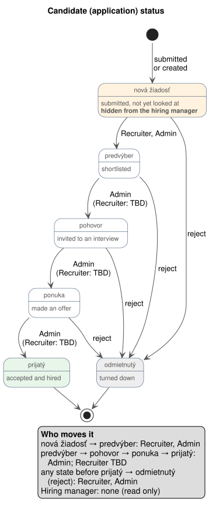

# Staff Roles & Permissions

**Scope:** What each staff role in HealthyHires may do: job posts, candidates (applications), candidate status changes and staff accounts. It is the target model; [§7](#7-implementation-status) lists where the code does not match it yet.

**Out of scope:**

- Applicants (the public). They are anonymous, browse published job posts and submit one application each; see [iam.md §3](iam.md#3-applicants--anonymous-access).
- How staff sign in and how roles reach the API (Entra app roles, the `roles` claim, the `staff-*` policies); see [iam.md §2.3](iam.md#23-roles-and-claims).

## 1. Roles

| Role | App role (value) | Who | In one sentence |
| ---- | ---------------- | --- | --------------- |
| **Admin** | `Admin` | Administrators (*administrátori*) | Can do everything below, on every job post and candidate. |
| **Hiring manager** | `HiringManager` | Hiring managers (*prijímajúci manažéri*), for whose team a position is filled | Creates and manages their own job posts and assigns a recruiter to them; only reads the candidates. |
| **Recruiter** | `Recruiter` | Recruiters (*náboroví pracovníci*), who run the hiring process | Works the candidates of the job posts they are assigned to; only reads the posts. |

A user can hold more than one role; their permissions are then the union of the roles' permissions.

**Which posts a role reaches.** Every permission below applies only within the role's reach:

| Role | Reaches |
| ---- | ------- |
| Admin | Every job post and every candidate |
| Hiring manager | The job posts they are the hiring manager of (`hiring_manager_id`), and the candidates on them |
| Recruiter | The job posts they are assigned to (`recruiter_id`), and the candidates on them |

A post outside the caller's reach is answered `404`, as if it did not exist, so its existence is not revealed.

## 2. Job posts

| Action | Admin | Hiring manager | Recruiter |
| ------ | :-----: | :--------------: | :---------: |
| See the list and detail of job posts (every status) | ✅ all | ✅ own | ✅ assigned |
| Create a job post (as a draft or published) | ✅ | ✅ | ❌ |
| Edit a job post, publish a draft | ✅ | ✅ own | ❌ |
| Close a published job post | ✅ | ✅ own | ❌ |
| Reopen a closed job post | ✅ | ✅ own | ❌ |
| Assign or change the recruiter of a job post | ✅ | ✅ own | ❌ |
| Name or change the hiring manager of a job post | ✅ | ❌ | ❌ |

**Rules**

- **Every job post has a hiring manager and a recruiter.** Neither can be left out.
  - A **hiring manager** creating a post is its hiring manager; they name its recruiter.
  - An **administrator** creating a post must name **both** its hiring manager and its recruiter.
- **An administrator can change a post's hiring manager** at any time, like its recruiter. The post then leaves the old hiring manager's reach and enters the new one's.
- **The named staff must hold the role.** The recruiter must have the `Recruiter` role and the hiring manager the `HiringManager` role; the pickers offer only such users.
- **Status moves `draft → published ⇄ closed`.** A published post never returns to a draft (applicants may have seen it); it is closed instead, and reopening publishes it again. See [recruitment.md](../db/modules/recruitment.md#job_post).

## 3. Candidates

A candidate is one application to one job post ([`recruitment.application`](../db/modules/recruitment.md#application)).

| Action | Admin | Hiring manager | Recruiter |
| ------ | :-----: | :--------------: | :---------: |
| See the list and detail of candidates | ✅ all | ✅ own posts | ✅ assigned posts |
| See candidates in `nová žiadosť` | ✅ | ❌ | ✅ |
| See candidates in every other state | ✅ | ✅ | ✅ |
| Create a candidate manually | ✅ | ❌ | ✅ |
| Update a candidate's details | ✅ | ❌ | ✅ |
| Change a candidate's status | ✅ | ❌ | ⚠️ partly, see [§4](#4-candidate-status) |
| Reject a candidate (`odmietnutý`) | ✅ | ❌ | ✅ |

**Rules**

- **The hiring manager never sees `nová žiadosť`.** A new application is first looked at by the recruiter, who either moves it to `predvýber` or rejects it. Only from `predvýber` on is it shown to the hiring manager, in the list, in the detail and in any counts.
- **A manually created candidate starts in `nová žiadosť`**, like a submitted application, and goes through the recruiter's `predvýber` in the same way.
- **The hiring manager only reads.** They cannot create, update, move or reject a candidate.

## 4. Candidate status

A candidate moves through the states in this order, and can be rejected (`odmietnutý`) from any of them before `prijatý`:

`nová žiadosť → predvýber → pohovor → ponuka → prijatý`

Source: [application-status.plantuml](../diagrams/api/application-status.plantuml).

| From | To | Admin | Hiring manager | Recruiter |
| ---- | -- | :---: | :------------: | :-------: |
| — (new) | `nová žiadosť` | ✅ manual create | ❌ | ✅ manual create |
| `nová žiadosť` | `predvýber` | ✅ | ❌ | ✅ |
| `predvýber` | `pohovor` | ✅ | ❌ | ❓ TBD |
| `pohovor` | `ponuka` | ✅ | ❌ | ❓ TBD |
| `ponuka` | `prijatý` | ✅ | ❌ | ❓ TBD |
| `nová žiadosť`, `predvýber`, `pohovor` or `ponuka` | `odmietnutý` | ✅ | ❌ | ✅ |

`prijatý` and `odmietnutý` are final: a hired candidate cannot be rejected. No other move (skipping a state, going back, leaving `odmietnutý`) is allowed. Every move carries the `version` the caller read ([optimistic locking](../db/conventions.md#optimistic-locking-version)).

## 5. Staff accounts and pickers

| Action | Admin | Hiring manager | Recruiter |
| ------ | :-----: | :--------------: | :---------: |
| Create a staff account (`POST /staff-users`) | ✅ | ❌ | ❌ |
| List staff accounts and their state (`GET /staff-users/manage`) | ✅ | ❌ | ❌ |
| List recruiters, to assign one to a post (`GET /recruiters`) | ✅ | ✅ | ❌ |
| List hiring managers, to assign one to a post (`GET /hiring-managers`) | ✅ | ❌ | ❌ |

Roles other than `Recruiter` are assigned in the Entra admin center ([iam.md §2.4](iam.md#24-session-management)).

## 6. API policies

The endpoints enforce the role with the `staff-*` policies ([iam.md §2.3](iam.md#23-roles-and-claims)); `Admin` passes every policy. The reach of [§1](#1-roles) (own, assigned, all) is not a policy: the handler filters on it with `JobPostAccess`, built from the caller's token.

| Policy | Admitted roles | Used for |
| ------ | -------------- | -------- |
| `staff` | Recruiter, Hiring manager, Admin | Reading posts and candidates within reach |
| `staff-recruiter` | Recruiter, Admin | Creating and updating candidates, moving and rejecting them |
| `staff-hiring-manager` | Hiring manager, Admin | Creating, editing, closing and reopening posts; the recruiter picker |
| `staff-admin` | Admin | Staff accounts; the hiring-manager picker |

## 7. Implementation status

Where the code (Recruitment module) differs from the model above:

| Area | Model | Code today |
| ---- | ----- | ---------- |
| Candidate status change | [§4](#4-candidate-status) | Not implemented |
| Candidate update | Recruiter, Admin | Not implemented |
| Attaching documents to a manually created candidate | Recruiter, Admin | Not implemented: `POST /applications` creates the candidate without documents |

## 8. Open questions

- [ ] May a recruiter move a candidate past `predvýber` (to `pohovor`, `ponuka`, `prijatý`), or only an administrator? If not the recruiter, should the hiring manager do it, given that they otherwise only read candidates?
